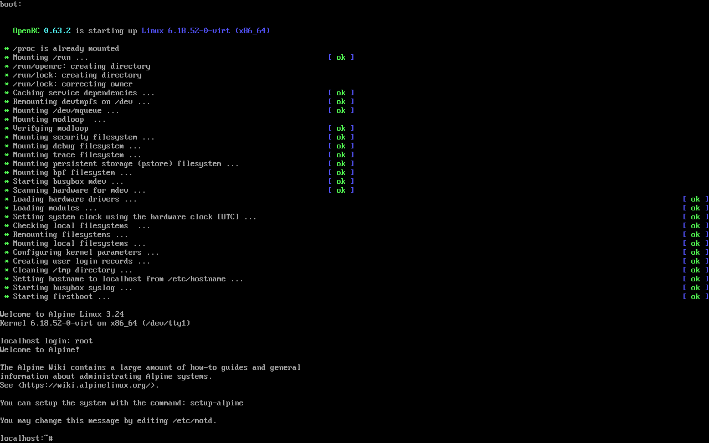
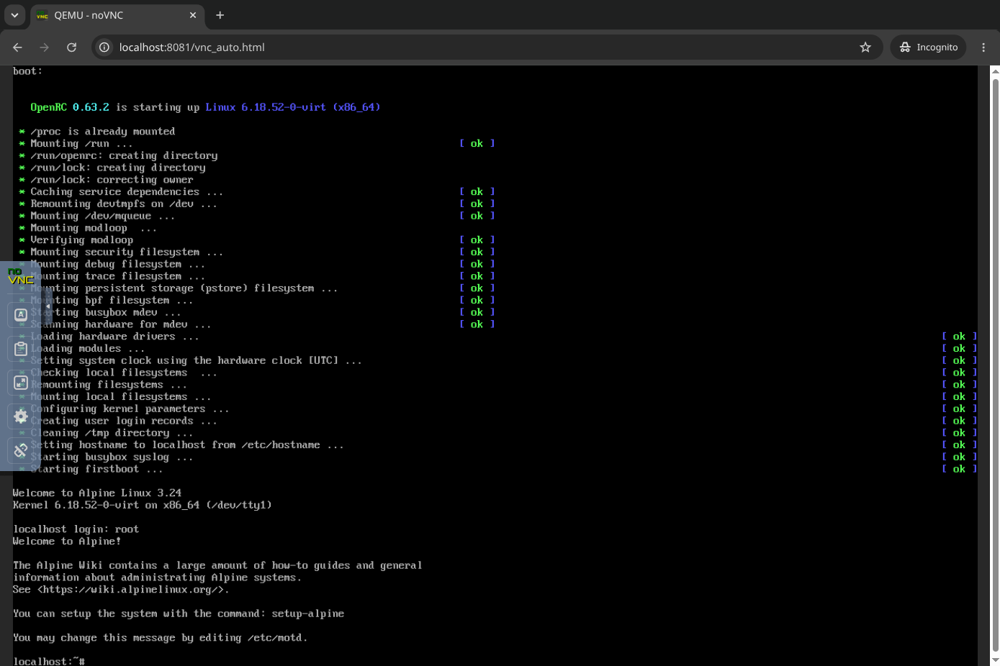
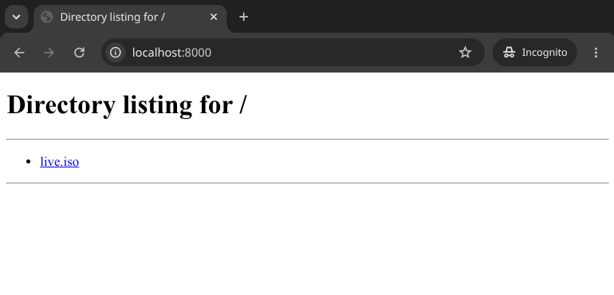

# docker-qemu-live-iso


This Docker image serves two purposes:

1. Boots a live ISO image in QEMU (based on [`ghcr.io/mmguero/qemu:native`](https://github.com/mmguero/docker-qemu), a fork of [`tianon/docker-qemu`](https://github.com/tianon/docker-qemu))
2. Provides an HTTP server from which the ISO itself can be downloaded

## Platforms

The image is published for `linux/amd64` and `linux/arm64` as a single multi-platform tag, so `docker pull` selects the right one for the host.

QEMU comes from [`ghcr.io/mmguero/qemu:native`](https://github.com/mmguero/docker-qemu), which contains only the system emulator for the host's own architecture: `qemu-system-x86_64` on `amd64` and `qemu-system-aarch64` on `arm64`.

Each platform bundles the [Alpine Linux](https://alpinelinux.org/) "virt" live ISO for its own architecture (`x86_64` or `aarch64`). It boots to a console login as `root` with no password. If the screen goes blank after the boot menu, the console output may be going to the serial port instead; see `docker logs`.

When providing your own ISO, use one built for the image's architecture. The HTTP download server works the same on both.

## Customizing the Docker image

By default this image is built with the example ISOs listed under [Platforms](#platforms), downloaded and checksum-verified in the `iso-amd64` and `iso-arm64` stages of the [`Dockerfile`](Dockerfile). Edit those stages to bundle different ISOs. Or, create a child Dockerfile based on this image to add a local ISO:

```
FROM oci.guero.org/qemu-live-iso:latest

ARG QEMU_CPU=4
ARG QEMU_RAM=4096
ENV QEMU_CPU $QEMU_CPU
ENV QEMU_RAM $QEMU_RAM

ADD --chown=${DEFAULT_UID}:${DEFAULT_GID} foobar.iso /image/live.iso
```

## Running

Set the following environment variables to control runtime parameters. See the [`Dockerfile`](Dockerfile) for a complete list of environment variables.

* `QEMU_CPU` - the number of CPU cores for QEMU (default `2`)
* `QEMU_RAM` - the megabytes of RAM for QEMU (default `1024`)
* `QEMU_START` - whether to start QEMU when the container is run (default `true`)
* `QEMU_RESTART` - whether to restart QEMU if it stops (default `true`)
* `NOVNC_START` - whether to start the noVNC web viewer (default `true`); this only affects browser access, since QEMU's own VNC server on `5900/tcp` runs whenever QEMU does
* `HTTP_SERVER_PORT` - the port for the ISO download server (default `8000`)
* `NOVNC_SERVER_PORT` - the port for the noVNC web viewer (default `8081`)

Additionally, you may bind mount your ISO as `/image/live.iso` in the container to boot your own ISO without rebuilding the Docker image:

```
$ docker run --detach --publish-all --rm --device /dev/kvm --volume /path/to/foobar.iso:/image/live.iso oci.guero.org/qemu-live-iso:latest
```

QEMU can take advantage of KVM acceleration if available. This can be accomplished by including `--device /dev/kvm` as illustrated in the example above.

Execute `docker run` with `--publish-all` (`-P`) and connect to the mapped HTTP and VNC ports to access the services provided by the container:

```
$ docker run --detach --publish-all --rm --device /dev/kvm oci.guero.org/qemu-live-iso:latest
fdaea77d8c383edc0689dd710b0df5c1187ad75b0b429e3ee56061d29fa6488c

$ docker ps -a | grep qemu-live-iso
fdaea77d8c38   oci.guero.org/qemu-live-iso      "/usr/bin/supervisor…"   10 seconds ago   Up 8 seconds    0.0.0.0:49190->22/tcp, 0.0.0.0:49169->5900/tcp, 0.0.0.0:49174->8000/tcp, 0.0.0.0:49191->8081/tcp   competent_black

```

### VNC client access

The VNC service is QEMU's own VNC server, mapped to `5900/tcp`, and can be connected to with your VNC client of choice (`vncviewer`, `remmina`, etc.). Sessions are always shared, so a VNC client and the browser viewer below can be connected at the same time:

```
$ remmina vnc://localhost:49169
```



### VNC HTTP access

Alternately, an HTML VNC client ([noVNC](https://github.com/novnc/noVNC)) connected to the same VNC server can be accessed via your browser at `http://localhost:XXXXX/vnc_auto.html`, where `XXXXX` is the port mapped to `8081/tcp` (unless `NOVNC_START` is `false`):



### ISO HTTP download

The HTTP service (for downloading the ISO) is the one mapped to `8000/tcp`, and can be accessed with a web browser:



## Security

Note that none of the services mentioned above are encrypted or otherwise secured. This image is intended for testing or internal use only, and may not be suitable for production use.